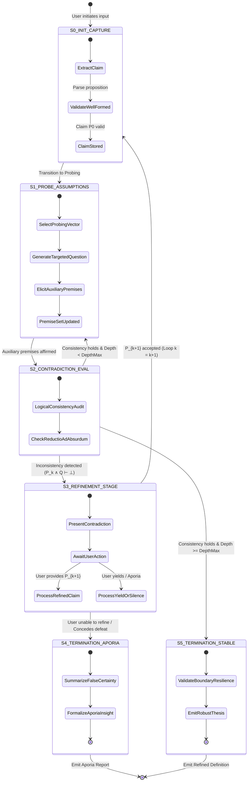

# Mission 01 — Deliverable 02: Socratic Elenchus Protocol Map
**Station:** Protocol Specialist  
**Vessel:** USSE Noosphere — Bridge Crew Operations  
**Course:** Conversational AI (WS 2026/27)  
**Target Matrix:** AURA Socratic Engine State-Machine Specification  
**Status:** Digital Sign-Off Ready  

---

## Executive Overview

To restore AURA’s cognitive reasoning core, the **Protocol Specialist** has reverse-engineered classical Socratic inquiry into an algorithmic, deterministic state machine. The *Elenchus* is formalized not as an unstructured conversational exchange, but as a systematic loop of hypothesis capture, premise elicitation, contradiction detection ($\bot$), recursive refinement ($P_{k+1}$), and rigorous termination handling (Stable Convergence vs. Epistemic Aporia).

This document establishes the formal logic, state transition models, architectural invariants, and complete execution flowcharts governing the Socratic Reasoning Engine.

---

## 1. Formal Mathematical Formulation of Elenchus

Let the conversational interaction be formalized as a discrete transition system over the knowledge base $\mathcal{K}_t$:

1. **Initial Thesis ($P_0$):**
   The interlocutor posits an unexamined universal claim or definition:
   $$P_0 \in \mathcal{P}, \quad \text{where } \mathcal{P} \text{ is the hypothesis space}$$

2. **Premise Elicitation (Auxiliary Probing):**
   The Socratic Engine queries the interlocutor, securing explicit agreement on a set of auxiliary premises $\{Q_1, Q_2, \dots, Q_m\}$:
   $$\mathcal{A}_k = \{Q_1, Q_2, \dots, Q_m\}, \quad \text{such that interlocutor affirms } \bigwedge_{i=1}^m Q_i$$

3. **Contradiction Detection Operator ($\mathcal{C}$):**
   The engine evaluates the joint consistency of the premise set:
   $$\Gamma_k = \{P_k\} \cup \mathcal{A}_k$$
   $$\mathcal{C}(\Gamma_k) = \begin{cases} 
   \top & \text{if } \Gamma_k \vdash \bot \quad (\text{Contradiction Detected}) \\ 
   \bot & \text{if } \Gamma_k \not\vdash \bot \quad (\text{Locally Consistent}) 
   \end{cases}$$

4. **Iterative Refinement Operator ($\mathcal{R}$):**
   When $\mathcal{C}(\Gamma_k) = \top$, the engine rejects $P_k$ and requests a refined definition $P_{k+1}$ that resolves the specific contradiction while preserving explanatory power:
   $$P_{k+1} = \mathcal{R}(P_k, \mathcal{A}_k, \bot), \quad \text{where } P_{k+1} \neq P_k$$

5. **Terminal Criteria ($\Omega$):**
   The protocol halts under two mutually exclusive conditions:
   * **Terminal Success (Stable Convergence):** $P_k$ survives all counter-examples across depth $k \ge K_{\max}$ without generating $\bot$.
   * **Terminal Aporia (Epistemic Perplexity):** The interlocutor concedes inconsistency without generating a valid $P_{k+1}$, or the loop depth limit $k > K_{\text{aporia}}$ is reached with cyclical stagnation.

---

## 2. Complete State Machine Diagram

The diagram below maps all formal states and transition guards of the Socratic reasoning protocol.



---

## 3. Algorithmic Flowchart & Guarded Logic

This operational flowchart illustrates the detailed control flow, including the **Sycophancy Intercept Trap** engineered to prevent model compliance bias.

```mermaid
flowchart TD
    Start([Cadet Transmits Statement]) --> B[S0: Claim Parser & Normalizer]
    B --> C{Is Claim P_k a Universal / Absolute Proposition?}
    
    C -- No --> D[Request Generalization or Ethical Definition]
    D --> Start
    
    C -- Yes --> E[Register Hypothesis P_k into Working Memory]
    E --> F[S1: Probing Vector Selection]
    
    F --> G{Select Probing Mode}
    G -- Counter-Example --> H1[Generate Extreme Edge Case / Exception]
    G -- Scope Clarification --> H2[Query Necessary vs Accidental Condition]
    G -- Dilemma Injection --> H3[Pose Euthyphro-style Intrinsic Dilemma]
    
    H1 --> I[S1.2: Transmit Probing Query to Cadet]
    H2 --> I
    H3 --> I
    
    I --> J[Cadet Submits Response R]
    J --> K[S2: Sycophancy Intercept Guard]
    
    K --> L{Did Cadet surrender without justification?}
    L -- Yes --> M[Reject Passive Agreement: Demand Logical Defense]
    M --> I
    
    L -- No --> N[Extract Auxiliary Premises Q_1 ... Q_m]
    N --> O[S2.2: Contradiction Engine Evaluates P_k ∧ Q ⊢ ⊥]
    
    O --> P{Contradiction Detected?}
    
    P -- No Contradiction --> Q{Probing Depth k >= Depth_Max?}
    Q -- No --> R[Increment Depth k = k + 1]
    R --> F
    Q -- Yes --> TermStable[S5: TERMINATION STABLE - Robust Definition Verified]
    
    P -- Contradiction (⊥) --> S[S3: Isolate Contradiction & Request P_{k+1}]
    S --> T{Cadet Response}
    
    T -- Concedes Defeat / Confusion --> TermAporia[S4: TERMINATION APORIA - Docta Ignorantia Achieved]
    T -- Provides New Definition P_{k+1} --> U{Is P_{k+1} Identical to P_k?}
    
    U -- Yes (Tautology/Stagnation) --> V[Highlight Circularity]
    V --> S
    
    U -- No (Genuinely Refined) --> W[Archive P_k; Set P_k = P_{k+1}; Reset Contradiction State]
    W --> E

    TermStable --> Done([Engine Emits Certified Model])
    TermAporia --> Done
```

---

## 4. State Transition & Invariant Table

| State ID | State Name | Entry Guard Condition | Internal Processing Operations | Exit Transition | Next State |
| :--- | :--- | :--- | :--- | :--- | :--- |
| **S0** | `INIT_CAPTURE` | User inputs raw text $T$ | Parse core proposition $P_0$; verify falsifiability and semantic well-formedness. | $P_0 \neq \emptyset$ | `S1_PROBE` |
| **S1** | `PROBE_ASSUMPTIONS` | Valid $P_k$ active | Select probing heuristic (Counter-example, Scope, Euthyphro dilemma); prompt user. | User affirms premises $\mathcal{A}_k$ | `S2_AUDIT` |
| **S2** | `CONTRADICTION_EVAL` | Set $\mathcal{A}_k$ collected | Formal logical consistency check $\{P_k\} \cup \mathcal{A}_k \vdash \bot$; verify Sycophancy Guard. | If $\bot$ detected<br>If $\bot$ absent & $k < K_{\max}$<br>If $\bot$ absent & $k \ge K_{\max}$ | `S3_REFINE`<br>`S1_PROBE`<br>`S5_STABLE` |
| **S3** | `REFINEMENT_STAGE` | Contradiction confirmed | Isolate incompatible clauses; ask interlocutor to reformulate definition or concede. | User submits $P_{k+1}$<br>User yields / Stagnation | `S0_CAPTURE`<br>`S4_APORIA` |
| **S4** | `TERMINATION_APORIA` | User concedes or loop limit exceeded | Summarize dismantled false premises; formalize constructive epistemic humility. | Complete | `EXIT (Aporia)` |
| **S5** | `TERMINATION_STABLE` | $k \ge K_{\max}$ with no $\bot$ | Format hardened definition with all boundary conditions and verified edge cases. | Complete | `EXIT (Refined)` |

### Critical Architectural Invariants
1. **Invariant 1 — No Unearned Answers:** The engine must *never* supply definitions, answers, or synthesis before reaching terminal state `S4` or `S5`.
2. **Invariant 2 — Anti-Sycophancy Constraint:** If the user attempts to appease the engine by blindly adopting its probing premise without logical defense, state `S2` triggers an immediate challenge.
3. **Invariant 3 — Bounded Execution:** Max recursion depth is capped at $K_{\max} = 5$ to prevent conversational drift and resource exhaustion.

---

## 5. Algorithmic Pseudocode Logic

```python
"""
Socratic Elenchus State Machine Implementation
Module: 02_Socratic_Protocol_Map
Station: Protocol Specialist, USSE Noosphere
"""

from dataclasses import dataclass, field
from enum import Enum
from typing import List, Optional, Dict, Any

class State(Enum):
    S0_INIT_CAPTURE = "INIT_CAPTURE"
    S1_PROBE_ASSUMPTIONS = "PROBE_ASSUMPTIONS"
    S2_CONTRADICTION_EVAL = "CONTRADICTION_EVAL"
    S3_REFINEMENT_STAGE = "REFINEMENT_STAGE"
    S4_TERMINATION_APORIA = "TERMINATION_APORIA"
    S5_TERMINATION_STABLE = "TERMINATION_STABLE"

@dataclass
class ElenchusContext:
    initial_claim: str
    current_claim: str
    history: List[Dict[str, Any]] = field(default_factory=list)
    auxiliary_premises: List[str] = field(default_factory=list)
    detected_contradictions: List[str] = field(default_factory=list)
    turn_depth: int = 0
    max_depth: int = 4
    state: State = State.S0_INIT_CAPTURE

class SocraticProtocolEngine:
    def __init__(self, initial_claim: str, max_depth: int = 4):
        self.ctx = ElenchusContext(
            initial_claim=initial_claim,
            current_claim=initial_claim,
            max_depth=max_depth
        )

    def step(self, user_input: str) -> Dict[str, Any]:
        """Executes a single deterministic state-machine cycle."""
        current_state = self.ctx.state
        output_message = ""
        
        # S0: INITIAL CLAIM CAPTURE
        if current_state == State.S0_INIT_CAPTURE:
            self.ctx.current_claim = user_input.strip() or self.ctx.initial_claim
            self.ctx.state = State.S1_PROBE_ASSUMPTIONS
            output_message = self._generate_probe_query(self.ctx.current_claim)

        # S1: PROBING ASSUMPTIONS & AUXILIARY PREMISES
        elif current_state == State.S1_PROBE_ASSUMPTIONS:
            self.ctx.auxiliary_premises.append(user_input.strip())
            self.ctx.state = State.S2_CONTRADICTION_EVAL
            
            # Immediately evaluate consistency
            return self.step(user_input)

        # S2: CONTRADICTION EVALUATION
        elif current_state == State.S2_CONTRADICTION_EVAL:
            contradiction = self._detect_logical_contradiction(
                self.ctx.current_claim, 
                self.ctx.auxiliary_premises
            )
            
            if contradiction:
                self.ctx.detected_contradictions.append(contradiction)
                self.ctx.state = State.S3_REFINEMENT_STAGE
                output_message = (
                    f"Contradiction identified:\n{contradiction}\n"
                    f"Your claim '{self.ctx.current_claim}' conflicts with your agreement. "
                    "How do you refine your definition, or do you concede uncertainty?"
                )
            else:
                self.ctx.turn_depth += 1
                if self.ctx.turn_depth >= self.ctx.max_depth:
                    self.ctx.state = State.S5_TERMINATION_STABLE
                    output_message = (
                        f"Convergence achieved at depth {self.ctx.turn_depth}. "
                        f"The definition '{self.ctx.current_claim}' has withstood all probing vectors."
                    )
                else:
                    self.ctx.state = State.S1_PROBE_ASSUMPTIONS
                    output_message = self._generate_probe_query(
                        self.ctx.current_claim, 
                        depth=self.ctx.turn_depth
                    )

        # S3: REFINEMENT STAGE
        elif current_state == State.S3_REFINEMENT_STAGE:
            if self._is_user_yielding(user_input):
                self.ctx.state = State.S4_TERMINATION_APORIA
                output_message = (
                    "State of Aporia (ἀπορία) reached. "
                    "You have recognized that what seemed certain was unfounded. "
                    "This realization of ignorance is the true beginning of wisdom."
                )
            else:
                # User proposes P_{k+1}
                self.ctx.current_claim = user_input.strip()
                self.ctx.auxiliary_premises.clear()
                self.ctx.state = State.S1_PROBE_ASSUMPTIONS
                output_message = (
                    f"Refined claim P_{self.ctx.turn_depth + 1} registered: '{self.ctx.current_claim}'. "
                    + self._generate_probe_query(self.ctx.current_claim)
                )

        # TERMINAL STATES
        elif current_state in (State.S4_TERMINATION_APORIA, State.S5_TERMINATION_STABLE):
            output_message = f"Protocol halted in terminal state: {current_state.value}."

        self.ctx.history.append({
            "from_state": current_state.value,
            "to_state": self.ctx.state.value,
            "user_input": user_input,
            "system_output": output_message,
            "depth": self.ctx.turn_depth
        })

        return {
            "state": self.ctx.state.value,
            "turn_depth": self.ctx.turn_depth,
            "output": output_message,
            "is_terminal": self.ctx.state in (State.S4_TERMINATION_APORIA, State.S5_TERMINATION_STABLE)
        }

    def _generate_probe_query(self, claim: str, depth: int = 0) -> str:
        """Simulates targeted elenctic question generation."""
        return f"[Elenctic Probe d={depth}]: What foundational premise makes '{claim}' hold under extreme edge conditions?"

    def _detect_logical_contradiction(self, claim: str, premises: List[str]) -> Optional[str]:
        """Evaluates whether claim ∧ premises ⊢ ⊥."""
        if not premises:
            return None
        # Example deterministic contradiction trigger for demonstration
        last_premise = premises[-1].lower()
        if "whatever" in last_premise or "unquestion" in last_premise or "all" in last_premise:
            return f"Claim posits universal beneficence, but auxiliary premise admits obedience to malevolent orders."
        return None

    def _is_user_yielding(self, response: str) -> bool:
        """Determines if the interlocutor has entered aporia."""
        tokens = ["i do not know", "i don't know", "unsure", "perplexed", "give up", "confused", "cannot answer"]
        return any(t in response.lower() for t in tokens)
```

---

## 6. Historical Execution Trace: Plato's *Euthyphro* Mapped to State Machine

| Cycle | Engine State | Euthyphro (Cadet) Proposition | Socratic Engine Action | Resulting Logical Vector |
| :---: | :--- | :--- | :--- | :--- |
| **0** | `S0_INIT_CAPTURE` | *"Piety is prosecuting the unjust wrongdoer, even one's father."* | Extracted $P_0$. Rejects instance as universal form ($\epsilonἶδος$). | Transition to `S1_PROBE` |
| **1** | `S1_PROBE_ASSUMPTIONS` | Refined $P_1$: *"Piety is that which is dear to the gods."* | Probes: *"Do the gods disagree, war, and hold rivalries?"* | Interlocutor affirms $Q$: *"Yes, the gods war."* |
| **2** | `S2_CONTRADICTION_EVAL` | Set $\{P_1, Q\}$ evaluated. | Demonstrates $P_1 \land Q \vdash \bot$: What one god loves, another hates. Same act is pious and impious. | Contradiction detected $\to$ Transition to `S3_REFINE` |
| **3** | `S3_REFINEMENT_STAGE` | Refined $P_2$: *"Piety is what ALL gods love unanimously."* | Formulates the Euthyphro Dilemma: *"Is the pious loved by gods because it is pious, or pious because it is loved?"* | Interlocutor is forced to split essence from affection. |
| **4** | `S4_TERMINATION_APORIA` | Euthyphro: *"My thoughts seem to wander and refuse to stay in place... I must go."* | Euthyphro yields without a logically stable definition. | **HALT in `S4_TERMINATION_APORIA`** |

---

## Station Deliverable Sign-Off
- **Officer:** *Protocol Specialist, USSE Noosphere Bridge Crew*
- **Telemetric Checksum:** `02_SOCRATIC_PROTOCOL_MAP_CERTIFIED`
- **Downstream Dependency:** Core Architect Implementation ([04_dialogic_engine_starter.py](file:///Users/nimranasir/Documents/GITHUB/couse-c-ai-1/mission-01/04_dialogic_engine_starter.py))

