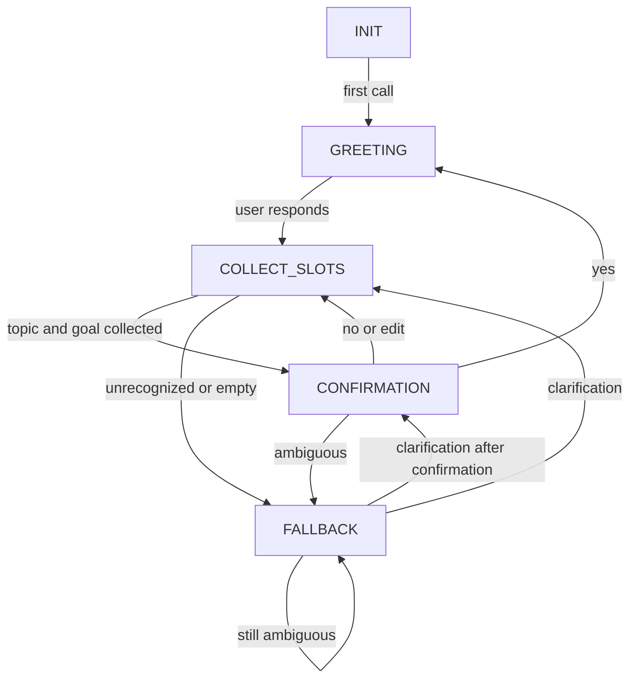

# Part 2 — Protocol Officer: FST Dialogue Manager & Noisy Channel Protocol

**Deliverable:** `02_FST_and_Noisy_Protocol.md`  
**Implementation:** `fst_dialogue_manager.py`  
**Focus:** State transducers and Shannon-style communication constraints

## 1. Objective

Implement a finite-state dialogue manager in Python with exactly five states, persistent slot memory during each session, and an output channel that limits responses to **seven whitespace-separated words** while substituting **one word per response** with a mandatory noise token. Explain how dialogue remains structured despite noisy transmission.

## 2. Architecture and state definitions

| State | Responsibility | Main transitions |
|---|---|---|
| `INIT` | Initialize a conversation | First `handle()` call → `GREETING` |
| `GREETING` | Welcome the user and request structured fields | Nonempty input → `COLLECT_SLOTS` |
| `COLLECT_SLOTS` | Store `topic` and `goal` independently | Both filled → `CONFIRMATION`; unrecognized input → `FALLBACK` |
| `CONFIRMATION` | Ask user to approve or revise stored fields | `yes` → `GREETING` (new session); `no`/`edit` → `COLLECT_SLOTS`; ambiguous → `FALLBACK` |
| `FALLBACK` | Request clarification, then retry the prior state | Next valid input → prior state; repeated ambiguity → `FALLBACK` |

**Slot memory buffer:** `{'topic': None, 'goal': None}`. Fields are stored until confirmation; successful confirmation resets both for a new dialogue. This is a simple, deterministic dialogue policy rather than a language-understanding model.

### State transition diagram



The flowchart depicts the intended transitions. `FALLBACK` stores the interrupted state, so recovery is context-dependent. A nonempty, recognized field entered on the first greeting turn is stored immediately.

## 3. Python implementation

The complete runnable source is supplied in the accompanying **`fst_dialogue_manager.py`**. Its central interface is:

```python
from fst_dialogue_manager import FSTDialogueManager

manager = FSTDialogueManager(seed=7)
print(manager.handle())
print(manager.handle('hello'))
print(manager.handle('topic: AI safety'))
print(manager.handle('goal: debate tradeoffs'))
print(manager.handle('yes'))
```

The implementation includes:

- `FSTDialogueManager.state`: current finite-state label.
- `FSTDialogueManager.slots`: remembered `topic` and `goal` values.
- `FSTDialogueManager.previous_state`: the state to resume after fallback.
- `FSTDialogueManager.handle(text)`: input processing, slot updates, and state transition.
- `FSTDialogueManager.noisy_channel(message)`: constrained response transformation.
- `FSTDialogueManager.history`: state and transmitted-output records.
- `shannon_entropy(items)`: empirical discrete-token entropy helper.

**Implementation scope:** Inputs are accepted using explicit prefixes (`topic:` and `goal:`), not free-form semantic extraction. The code does not call an external LLM. It is suitable as a testable finite-state protocol module that can later be connected to one.

## 4. Noisy channel specification

Allowed substitution vocabulary:

`{Banana, Labyrinth, Quantum, Midnight, Velocity, Green, Cosmological}`

For each generated response:

1. Generate the canonical message for the active dialogue state.
2. Split the message on whitespace.
3. Keep at most the first seven words.
4. Replace **exactly one** word (the last retained word) with a randomly selected token from the allowed vocabulary.
5. Join the words and transmit them.

This satisfies the literal seven-word maximum and mandatory token substitution. A seeded pseudo-random generator makes tests reproducible. The last-word policy preserves the message prefix, but may erase essential information near the end; this is an intentional hazard for Part 3 to audit.

### Example trace (seed = 7)

| Input | State after input | Transmitted output |
|---|---|---|
| First `handle()` call | `GREETING` | `Hello. I can help plan a Quantum` |
| `hello` | `COLLECT_SLOTS` | `Provide topic: and goal: separately Labyrinth` |
| `topic: AI safety` | `COLLECT_SLOTS` | `Recorded. Please provide goal: Midnight` |
| `goal: debate tradeoffs` | `CONFIRMATION` | `Both slots recorded. Confirm yes or Green` |
| `maybe` | `FALLBACK` | `Please answer yes, no, or Banana` |
| `yes` | `GREETING` | `Confirmed. Dialogue plan saved. Start Banana` |

Every transmitted output shown contains at most seven words and one allowed noise token. The examples are **actual results from the supplied Python implementation**, not invented ideal outputs.

## 5. Signal reduction strategy

A limited-capacity channel cannot preserve all natural-language detail. To retain conversational coherence, the manager uses:

- **State compression:** one of five known states replaces a long history of instructions.
- **Slot memory:** essential facts (`topic`, `goal`) are stored separately from noisy outputs.
- **Explicit field labels:** `topic:` and `goal:` act as robust input delimiters.
- **Short prompts:** brief responses reduce truncation risk.
- **Confirmation and repair:** users can approve, revise, or clarify rather than relying on one ambiguous turn.
- **Deterministic policy:** identical recognized inputs in the same state trigger the same transition, while only the noise token changes.

### Shannon channel interpretation

For discrete tokens with probabilities \(p_i\), Shannon entropy is

\[
H(X)=-\sum_i p_i\log_2 p_i.
\]

If all seven noise tokens are equally likely, noise-token entropy is \(\log_2 7 \approx 2.807\) bits per substitution. This measures uncertainty in the noise token, **not** how much intended meaning is lost. Semantic loss must be audited separately.

## 6. Test strategy and reproducibility

Run in a terminal from the folder containing both Python files:

```bash
python -m unittest -v test_fst.py
python fst_dialogue_manager.py
```

The test suite verifies state transitions and slot memory, fallback recovery, the seven-word/noise-token rule, and basic entropy calculations. **Observed test result: 4 tests passed** in the execution environment used to prepare this submission.

## 7. Limitations and improvements

The system currently relies on prefix-based input parsing. It does not reliably understand paraphrases, mixed intents, or multiple slots in one sentence. Replacing the last word can remove a critical command such as `no`, harming usability. For deployment, reserve control words from substitution, repeat confirmations through an independent reliable channel, add input validation, and test adversarial or unusual phrasing. Those improvements may alter the strict substitution policy and should be documented as a revised protocol.

## 8. Conclusion

The delivered Python module implements the requested five-state finite-state dialogue manager with slot memory and a mandatory noisy channel. The design maintains basic dialogue structure through state, slots, and repair, while Part 3 quantifies and documents the hazards of severe noise.
